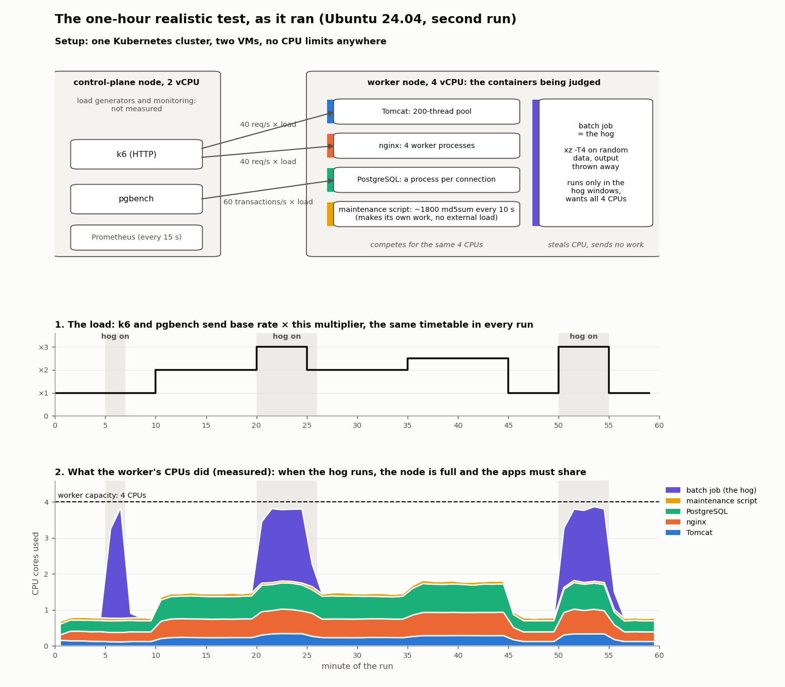

# Validation: can CPU wait replace PSI?

This page summarises the tests behind tare-agent: what was measured, how, and what came
out. What the agent is and how to deploy it are in [`OVERVIEW.md`](OVERVIEW.md) and
[`README.md`](README.md).

## The problem

tare recommends CPU requests and limits for Kubernetes containers. Before it suggests
**lowering** a container's CPU, it checks that the container is not already short of
CPU. It does that with **PSI** (Pressure Stall Information), a Linux kernel measurement
that the kubelet exports as `container_pressure_cpu_waiting_seconds_total`. It is the
share of time in which at least one of the container's tasks was ready to run but had no
CPU to run on: 0 means never, 1 means all the time.

tare's rule: if PSI goes above **0.03** (3% of the time) in any minute of the period it
analyses, and the container used at least half of its CPU allocation in that period, the
container is **saturated** and tare never lowers its CPU.

Many clusters have no PSI:

- nodes on **cgroup v1**, the older layout of the kernel's resource groups (cgroups);
  per-container PSI exists only with cgroup v2;
- **RHEL 8, 9 and 10** and their rebuilds (Rocky Linux, AlmaLinux): the kernel supports
  PSI but ships with it switched off;
- **kubelets older than 1.33**, which do not export it.

There tare sees no pressure at all, and "no pressure" is exactly what it reads as "safe
to lower the CPU". The tests look for another per-container signal that leads to the same
decisions.

## The candidate signals

Independently of PSI, the Linux scheduler records for every thread how long it has spent
**waiting in the run queue**: ready to run, but waiting for a CPU. Added up over all the
threads of a container, this is the container's waiting time, in seconds per second
(s/s). Three ways of collecting it were compared:

| signal | how it is collected | what it misses |
|---|---|---|
| **cAdvisor run-queue** | `container_cpu_schedstat_runqueue_seconds_total`, from a separately installed cAdvisor (the kubelet's built-in cAdvisor never exports it). Every 10 s it reads one counter per process | the counter it reads belongs to each process's **main thread only**, so worker threads are invisible; processes that start and end between two reads are never seen |
| **live-threads wait** | the same counter, read for **every thread** of every process in the container, each time Prometheus collects | processes that start and end between two collections |
| **CPU wait** | live-threads wait, **plus** the final counters of every thread at the moment it exits, which the kernel sends to the agent as it happens | nothing measurable; see coverage below |

**CPU wait** is what tare-agent exports, as `tare_cpu_wait_seconds_total`.

Two derived quantities are used throughout:

- **coverage**: the CPU time a method accounted for, divided by the container's real CPU
  usage as the kubelet reports it. 1.0 means it saw every task of the container; 0.1 means
  it saw a tenth of the work, so it can see at most about a tenth of the waiting.
- **slowdown**: CPU wait divided by CPU usage, i.e. seconds spent waiting for every second
  spent running. A container waits more simply because it runs more; slowdown removes
  that effect.

## How the tests were run

Each test built a fresh Kubernetes cluster of two virtual machines: a 2-vCPU
**control-plane node** (monitoring and load generators, not judged) and a 4-vCPU
**worker** (the applications being judged). Prometheus collected all metrics every 15
seconds.

The worker ran a realistic mix of applications, with **no CPU limits**, so no container
was throttled; they only competed for the worker's 4 CPUs:

| container | what it is | why it is included |
|---|---|---|
| Tomcat | Java web server with CPU-heavy pages | its work is done by a pool of 200 threads, not by the main thread |
| nginx | web server compressing a 170 KB response | 4 long-lived processes: the easy case |
| PostgreSQL | database, a new connection per transaction | a new process for every connection |
| maintenance script | about 1800 tiny `md5sum` processes every 10 seconds | very short-lived processes |
| batch job (**the hog**) | `xz` compressing random data with 4 threads, output thrown away | does no useful work; only takes CPU from the others, in three planned time windows |

On the control-plane node, two load generators sent the work: **k6** (HTTP requests to
Tomcat and nginx) and **pgbench** (transactions to PostgreSQL).

Each run lasted **one hour**:

- the load followed the same timetable in every run, from 1× to 3× a base rate (40
  requests/s to Tomcat, 40 to nginx, 60 transactions/s to PostgreSQL);
- the hog ran at minutes 5–6, 20–25 and 50–54. In the first Ubuntu run it failed to stop
  and ran from minute 20 to 55; the results use what actually happened, not the plan.

One run (Ubuntu 24.04; the others have the same shape). Panel 1 is the load, panel 2 the
CPU each container used on the worker. The grey bands are the minutes in which the hog
ran: there the worker is full and the applications must share its CPUs. That is the
contention a signal has to detect.

### How a signal is turned into a verdict

tare judges pressure on **5-minute windows**. In these tests a window ends at **every
minute** (minutes 0–4, 1–5, 2–6, …), so consecutive windows overlap by 4 minutes. In each
window, each signal is averaged and a rule turns it into a verdict, **saturated** or **not
saturated**, per container. All thresholds were **fixed before the runs** and never
adjusted on the data they were scored on.

### The answer key: was the container really contended?

The experiment controls the contention, so it knows the right answer without looking at
any metric: a window is

- **contended** if the hog ran in at least 3 of its 5 minutes;
- **not contended** if the hog did not run at all;
- **left out** if the hog ran 1 or 2 minutes (too ambiguous to grade).

For example, the window of minutes 18–22 contains 3 hog minutes (20, 21, 22): contended.
The window 26–30 contains none: not contended.

The key is the same for the four worker applications, and it grades PSI and CPU wait
alike. It also exists on clusters without PSI.

### Two kinds of mistake

| | contended | not contended |
|---|---|---|
| **rule says saturated** | right | **false alarm**: tare keeps CPU that was not needed |
| **rule says not saturated** | **wrong shrink**: tare could lower the CPU of a starved container. The dangerous mistake | right |

### Where it was run

The same hour was repeated on seven setups (all Kubernetes, same VM sizes, same workload):

| setup | kernel | cgroup | container runtime | PSI |
|---|---|---|---|---|
| Ubuntu 24.04, twice | 6.8 | v2 | containerd | yes |
| Debian 12 | 6.1 | v2 | containerd | yes |
| AlmaLinux 9 (RHEL 9) | 5.14 | v2 | containerd | off by default, switched on to have a reference |
| AlmaLinux 10 (RHEL 10) | 6.12 | v2 | containerd | off by default, switched on to have a reference |
| Ubuntu 24.04 with CRI-O | 6.8 | v2 | CRI-O | yes |
| Debian 11 | 5.10 | **v1** | containerd | **none per container**: the case the agent is for |

## Results

### 1. What each signal sees

Coverage per container, median over the runs (1.00 = sees all of it):

| container | cAdvisor run-queue | live-threads wait | CPU wait |
|---|---|---|---|
| Tomcat (threads) | **0.00** | 1.00 | 1.00 |
| nginx (long-lived processes) | 1.00 | 1.00 | 1.00 |
| PostgreSQL (a process per connection) | **0.09** | **0.09** | 0.86 |
| maintenance script (tiny processes) | **0.01** | **0.01** | 0.85 |
| batch job (threads) | **0.01** | 1.00 | 1.00 |

- **cAdvisor run-queue** reads zero for Tomcat even when it is heavily contended, which
  tare would take as "safe to lower". It is not usable.
- **Live-threads wait** misses the short-lived processes.
- **CPU wait** sees both. Its 0.85 on process-heavy containers is most likely the CPU a
  process spends being torn down (freeing its memory) after the kernel has already sent
  its final counters. That CPU is real usage, but no task waits during it to any relevant
  extent: CPU wait and PSI rise and fall together for these containers (rank correlation
  0.98). PSI has no such gap, because the kernel computes it for the container as a whole
  instead of adding up per-task counters.

### 2. CPU wait with a fixed threshold, against PSI

The first approach was to use CPU wait the way tare uses PSI: saturated when the 5-minute
average is above a fixed threshold, 0.0435 s/s (chosen on an earlier test with
artificial workloads). It was compared with PSI's own verdict (5-minute average above
0.03) on the six setups that have PSI:

- same verdict as PSI in **78–93%** of windows;
- almost never "not saturated" where PSI said "saturated" (no such window on five setups,
  1 on AlmaLinux 10): it would essentially never let tare shrink a container PSI calls
  starved;
- over the whole hour, its verdict per container matched PSI's on all 7 containers
  (including k6 and pgbench) on five setups, and on 6 of 7 on AlmaLinux 10, where Tomcat's
  PSI was 0.029, just under the line.

The disagreements are false alarms on containers with many tasks running at once (Tomcat,
nginx). PSI counts the time in which **at least one** task waits, so it never exceeds 1.
CPU wait **adds up** the waits of all tasks, so with four tasks waiting together it reads
four times as much. A single fixed threshold therefore fires earlier for highly concurrent
containers.

On cgroup v1 there is no PSI on the same cluster to compare with. Compared with the PSI
verdicts for the same container and window on the four other clusters, CPU wait agreed in
89–91% of windows, about as often as those clusters agree with each other.

### 3. Rules graded against the answer key

Agreement with PSI only measures how well a signal imitates PSI. The answer key measures
whether it is right. Rules tested on CPU wait:

| rule | saturated when |
|---|---|
| `absolute-wait` | CPU wait ≥ 0.0435 s/s (the fixed threshold above) |
| `fixed-slowdown` | slowdown ≥ a fixed cut (1, or 0.488), and CPU wait ≥ 0.01 s/s |
| `relative-slowdown` | slowdown ≥ k × the container's own **normal** slowdown, and CPU wait ≥ 0.01 s/s; or slowdown ≥ 1 whatever the normal |

The 0.01 s/s floor stops nearly idle containers from ever being called saturated.

**The normal** is how slow the container is when nothing is wrong. Take all its 5-minute
windows in the period, leave out those where it barely ran or barely waited, and take the
**10th percentile** of their slowdowns: the container is at least this slow 90% of the
time. Not the minimum, which one unusually calm window would distort; not the median,
which would be the contended state for a container contended half the time. In these tests
the normal came from the same hour being judged; in production it would come from the
previous days.

The four worker applications on all seven setups: 1,232 graded windows, 448 contended.

| rule | right | wrong shrinks | false alarms |
|---|---|---|---|
| `absolute-wait` | 68.2% | 10 | 382 |
| `fixed-slowdown`, cut 1 | 94.6% | 66 | 0 |
| `fixed-slowdown`, cut 0.488 | 93.0% | 36 | 50 |
| **`relative-slowdown`, k = 2** | **98.5%** | **5** | **14** |
| `relative-slowdown`, k = 3 | 97.9% | 16 | 10 |
| `relative-slowdown`, k = 4 | 97.1% | 29 | 7 |

PSI only exists on six of the setups (1,056 graded windows). There:

| rule | right | wrong shrinks | false alarms |
|---|---|---|---|
| **`relative-slowdown`, k = 2** | **98.4%** | **5** | **12** |
| PSI, 5-minute average > 0.03 | 91.6% | 12 | 77 |
| PSI, highest minute > 0.03 | 88.0% | 3 | 124 |
| PSI, highest minute > 0.03 and usage ≥ half the request (**tare today**) | 86.8% | 18 | 121 |

`relative-slowdown` with k = 2 is the best rule on every setup, cgroup v1 included (98.9%,
no wrong shrinks).

Why it works: containers differ a lot in how slow they are on a quiet node. nginx's normal
slowdown is about 0.04; the maintenance script's is about 0.4, because each of its tiny
processes waits briefly before it first runs. Contention multiplies every container's
slowdown by 5 to 100. A single line for all containers cannot fit both; comparing each
container with its own normal can.

### 4. PSI itself makes mistakes

PSI's 5-minute average against the 0.03 line was right 91.6% of the time:

- **77 false alarms**, 70 of them PostgreSQL under high load with the hog not running. Its
  PSI grows with its own load and crosses 0.03, although it received all the CPU its load
  needed: its own processes queue behind each other.
- **12 wrong shrinks**: Tomcat at the start of a hog window, with PSI only 0.014–0.025.

As a raw signal PSI separates contended from quiet windows as well as CPU wait does; the
single fixed line is the problem. Moving it does not help (at 0.05 PSI is right 96.3% of
the time but makes twice the wrong shrinks), and comparing PSI with the container's own
normal does not help either, because PSI's quiet values are too small and noisy.

tare's actual rule does worse than the average:

- **Using the highest minute** instead of the average cuts the wrong shrinks from 12 to 3
  but raises the false alarms from 77 to 124, 102 of them PostgreSQL: every short burst of
  its own queueing crosses the line.
- **The usage check** brings the wrong shrinks back to 18. In 15 of them PSI had seen the
  pressure (peaks of 0.03–0.09), but Tomcat was using only 26–46% of its 0.5-core request,
  so tare would have allowed lowering it. With no CPU limits, the request is what protects
  a container when the CPUs are contended, so lowering it makes the starvation worse. These
  15 depend on the requests chosen in this test: with a Tomcat request below about 0.25
  cores the check would have passed.

### 5. The weak spot: containers that are never quiet

A container that is **always** contended has no quiet normal: its normal already is the
contended state. In these tests that was k6, the load generator on the busy 2-vCPU
control-plane node (slowdown about 0.95 for the whole hour). It is not in the answer key,
but PSI called it saturated and `relative-slowdown` did not. The fix: a container whose
normal slowdown is **0.6 or more** is reported as **UNVERIFIED** (tare makes no
recommendation). That removed all of k6's misses at no cost on the four applications,
whose normals were all 0.44 or less.

### 6. What CPU wait cannot do

It cannot tell **how much** CPU to add. The load was fixed, so the CPU each application
needed is known from the quiet minutes. Under contention they lost only 2–34% of it, while
"usage + CPU wait" suggested 2 to 7 times more. Waiting delays work; it does not add work.

### 7. Without a privileged agent

Collecting CPU wait needs a privileged agent on every node. The cheaper alternative uses
metrics most clusters already have: node-level PSI (which exists on more kernels than the
per-container one) combined with each container's usage against its CPU request. On the
second Ubuntu run it agreed with per-container PSI only about 76% of the time and made
**43–54 wrong shrinks** in the hour. It tells that the node is busy, not which container is
waiting.

### 8. The agent itself

The results above were collected with a first prototype written in Python. tare-agent (Go)
was then run next to it on cgroup v1, CRI-O (one hour each) and AlmaLinux 10 (30 minutes):

- CPU wait per container within 0.2% of the prototype, except the maintenance script
  (0.7–6.6%);
- no unrecognised kernel records, no lost exit notifications, and 1–3% of exits that
  could not be assigned to a container;
- about **0.05 CPU cores and 20 MiB of memory** on the busy worker (about 280 process exits
  per second), 0.002 cores on the quiet node;
- on AlmaLinux 10, tare's decision with `relative-slowdown` in place of PSI was the same as
  with PSI for every container, both over the whole run and over 15-minute periods.

## Problems found on the way

Each of these made CPU wait **silently wrong** (no error, just wrong numbers) on one setup.
Each was caught by a self-check the agent now exports (coverage, the share of exits not
assigned to a container, or whether its container ids match the kubelet's), and each is
fixed in the agent.

| setup | problem | fix |
|---|---|---|
| AlmaLinux 10 | the kernel's exit record is laid out differently from the standard kernel's, under the same version number: half the exits could not be assigned | recognise the layout of each record |
| Debian 11, cgroup v1 | an exiting process reports a group outside its pod | fall back to its parent process |
| CRI-O | processes live in a sub-group of the container's group | map the sub-group to the container |

## Conclusions

1. **cAdvisor's run-queue metric cannot replace PSI**: it is blind to thread pools and to
   short-lived processes.
2. **CPU wait sees what PSI sees**, on every kernel, distribution, container runtime and
   cgroup version tested.
3. **Decide with `relative-slowdown` (k = 2)**, not with a fixed threshold: 98.5% right
   against real contention, 5 wrong shrinks in 1,232 windows, better than PSI as tare uses
   it today (86.8%, 18 wrong shrinks; 91.6% and 12 with the 5-minute average). Containers
   that are never quiet must be reported as UNVERIFIED.
4. **CPU wait says whether a container ran slower, not how much CPU it is missing.**
5. **It needs a privileged agent** (host process ids, host network, `CAP_NET_ADMIN`); the
   signals available without one make unsafe mistakes.

## Limits

- The normal slowdown was computed from the same hour it was judged on; in production it
  would come from previous days, which has not been tested.
- "Hog running" counts as contended for all four applications, whether or not each was
  really affected.
- One application mix on one VM size; most setups were run once.
- Where CPU wait and PSI disagree, it is mostly about mild waiting (PSI between 0.03 and
  0.05). Which of the two is right there needs latency measurements, which have not been
  made yet.
